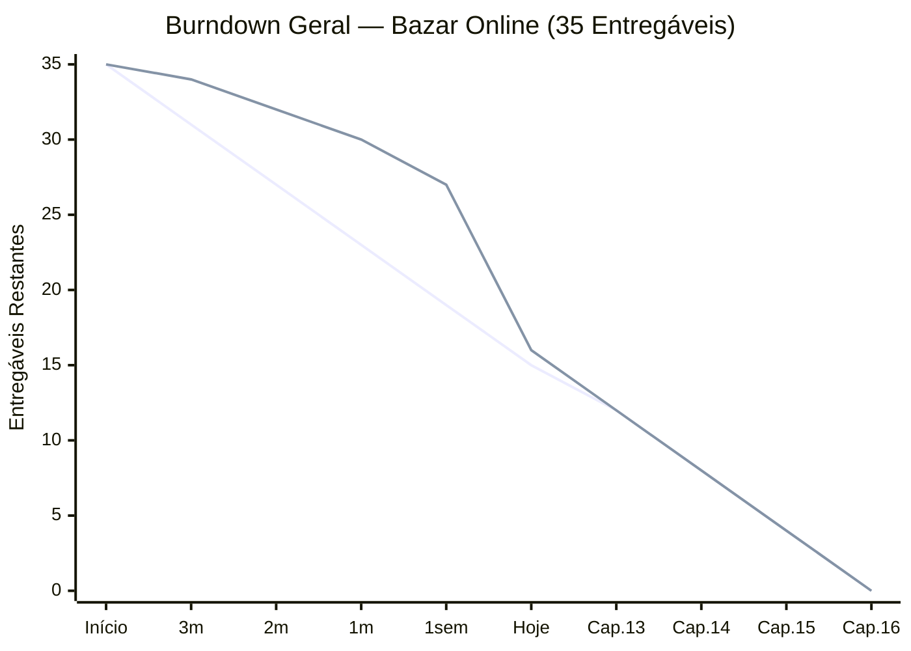

# Bazar Online

## Sobre o projeto

O Bazar Online é uma plataforma web voltada para a compra e venda de produtos, como roupas, calçados, acessórios e outros itens.

A proposta do projeto é desenvolver um ambiente virtual simples e organizado, no qual os usuários possam visualizar produtos disponíveis, consultar suas informações e encontrar itens de seu interesse de forma prática.

O projeto está sendo desenvolvido como atividade da disciplina de Engenharia de Software, utilizando práticas de desenvolvimento colaborativo com Git e GitHub.

## Problema

A compra e venda de produtos usados ou novos entre moradores de Palmas é frequentemente realizada por meio de redes sociais e aplicativos de mensagens. Entretanto, essas ferramentas não são especificamente voltadas para a organização de anúncios, o que pode dificultar a busca por produtos disponíveis na cidade.

Além disso, os anúncios podem ficar dispersos entre diferentes grupos, páginas e conversas, tornando mais difícil encontrar produtos específicos, comparar opções e entrar em contato com os vendedores.

Diante desse problema, o projeto propõe o desenvolvimento de uma plataforma de bazar online voltada para os moradores de Palmas, Tocantins, permitindo a organização dos produtos em um único ambiente.

Dessa forma, os compradores poderão encontrar produtos disponíveis em Palmas de maneira mais prática, facilitando a busca, a comunicação e a negociação entre compradores e vendedores e, quando possível, a retirada presencial dos produtos.

## Objetivo

Desenvolver uma plataforma de bazar online voltada para os moradores de Palmas, Tocantins, permitindo a compra e venda de roupas, calçados, acessórios e outros produtos em um único ambiente.

A plataforma terá como foco facilitar a busca, divulgação e negociação de produtos entre compradores e vendedores da cidade, proporcionando uma experiência simples e organizada para a compra e venda local.

## Funcionalidades previstas

- [ ] Cadastro de usuário
- [ ] Cadastro de produtos
- [ ] Listagem de produtos disponíveis
- [ ] Busca por produtos
- [ ] Filtro por categoria
- [ ] Visualização dos detalhes do produto

## Equipe

- Raylla Ruthiely Gomes Santana | https://github.com/RayllaRuthiely
- Alana Farias Silva | https://github.com/alana1789
- Samuel Felipe De Sena Estevão | https://github.com/felipe-sena39
- João Guilherme Aguiar Lustosa | https://github.com/jguiaguiar
- Maria Eduarda Rodrigues Lima | https://github.com/edoardarl

## Tecnologias

- **Linguagem:** Python 3.12+
- **Framework Web:** Flask
- **Banco de Dados:** MySQL (`mysql-connector-python`)
- **Testes e Qualidade:** Pytest, `pytest-cov` e Ruff
- **Integração Contínua:** GitHub Actions

## Como executar

1. **Clonar o repositório e ativar o ambiente virtual:**
   ```bash
   git clone https://github.com
   cd ES-Bazar-Online
   python -m venv venv
   ```

2. **Instalar as dependências da aplicação e de testes:**
   ```bash
   pip install -r requirements-dev.txt
   ```

3. **Executar a aplicação Flask:**
   ```bash
   python CodigoFonte/app.py
   ```

4. **Executar a suíte de testes automatizados e cobertura:**
   ```bash
   pytest -v --cov=CodigoFonte --cov-report=term-missing
   ```

## Status

Projeto em desenvolvimento (**19 de 35 entregáveis concluídos** — Capítulos 1 a 12 finalizados; Capítulos 13 a 16 planejados).

### Gráfico de Burndown — Evolução e Entregas Restantes



**Legenda:**
* 🔵 **Linha Azul (Meta Ideal):** Ritmo linear esperado ao longo do semestre.
* 🟢 **Linha Verde (Real + Projeção):** Progresso real até hoje (**16 entregáveis restantes**) e planejamento para os Capítulos 13 a 16 até a versão `v1.0.0`.


## Licença

Este projeto está sob a licença MIT.
